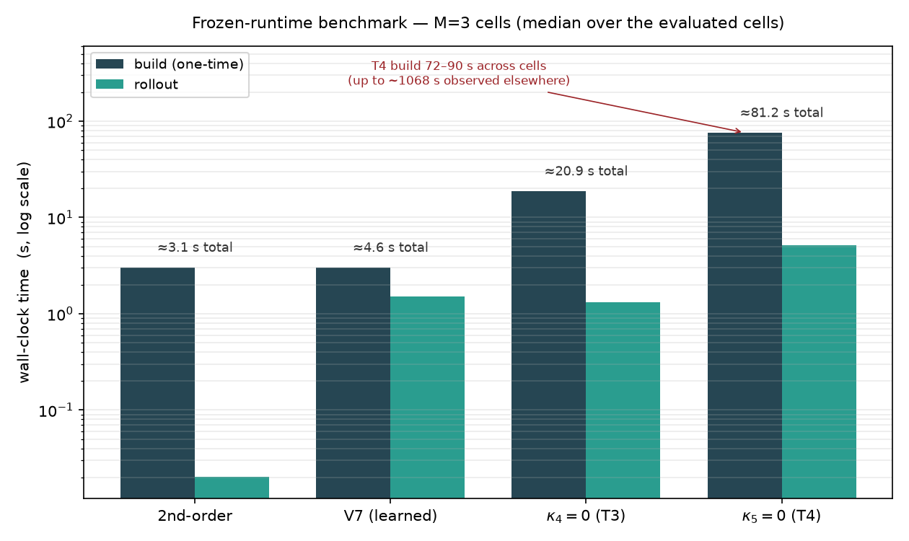
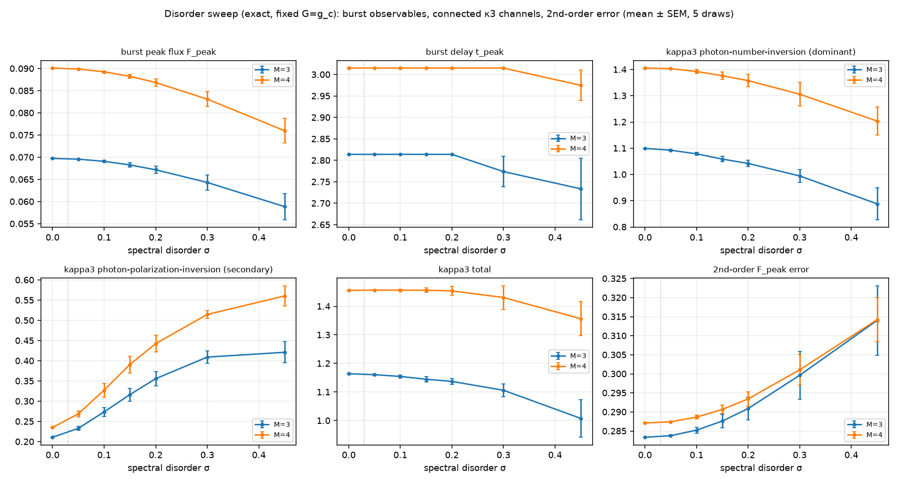

<div align="center">

# Learned Cumulant Closure

### Recovering the superradiant burst peak where the tested cumulant truncations miss it

Second-order cumulants **overshoot** the superradiant burst peak. Fourth-order **runs away**. A small,
structure-preserving **learned third-cumulant closure** tracks the exact burst peak at small M and stays several
times more accurate than second order out to M = 16, in an open, *disordered* cavity–emitter model where the
tested truncations through fourth order do not. Its limits are measured, not assumed: its error grows with M,
and in the low-loss regime its trajectories leave the physical set at late times from M ≈ 10. Every extension
that *didn't* survive is kept in the record.

[](https://github.com/Dhruvjain35/learned-cumulant-closure/actions/workflows/ci.yml)
&nbsp;
&nbsp;
&nbsp;
&nbsp;
&nbsp;

</div>

---

## TL;DR

> On the **superradiant burst peak** of an open, disordered Tavis–Cummings ensemble — a measurable
> collective-emission observable — the standard second-order cumulant closure is off by ≈ **+29%**, the tested
> κ4 = 0 third-order closure by ≈ **−25% to −28%** (and it runs away in the low-loss pocket), and the κ5 = 0 fourth-order
> closure **runs away** — its integration triggers a divergence guard. A frozen, physics-routed **learned closure
> (V7)**, measured against exact (and, at M = 12 with disorder, quantum-trajectory) references:
>
> - **Small M, original cells:** ≈ **±0.7%** at M ≤ 5 (24 cells; the disorder draw is held out, the parameters
>   are on or just outside the training grid).
> - **Held-out physical parameters (pre-registered):** at M = 5, on 30 parameter points absent from training
>   (interpolation and one- and two-axis extrapolation, both branches), V7 beats second order in **30/30**
>   cells. Median error **0.47%**, worst **1.46%**, against 28.5–33.1% for second order.
> - **Unseen M:** the error grows ≈ 0.8–0.9 points per emitter, to ≈ 8–9% at M = 16 (zero disorder) and 4–6% at
>   M = 12 (one disordered draw), against ≈ 30% for second order.
> - **Large-M physicality:** in the low-loss regime the trajectories still leave the physical set at late times
>   on some draws from M ≈ 10, even where the burst peak itself remains accurate.
>
> This repo has the engines, the learned closure, the mechanism analysis, the rejected hypotheses, and two
> reproduction packages:
> - the second-order result, reproduced cross-platform in QuantumCumulants.jl by an outside collaborator at the
>   Notre Dame CRC (2026-08-30, `external_validation/`);
> - a portable frozen-V7 package (`portable_v7/`) prepared for an outside run, which is pending. The learned
>   closure has not yet been run outside this work.

## The result in one table

Signed burst-peak error vs. an exact master-equation solve, in the evaluated disordered open-cavity cells:

| closure | burst peak vs. exact | stability | cost |
|---|---|---|---|
| mean-field | no burst from these ICs | — | trivial |
| **2nd-order cumulant** | overshoots ≈ **+29%** | stable | no high-order engine to construct |
| κ4 = 0 (3rd-order) | undershoots ≈ **−25% to −28%** | runaway growth (guard triggered) in the low-loss pocket | heavier than 2nd; M = 4 pocket case failed |
| κ5 = 0 (4th-order) | overshoots, then **runaway growth** | guard triggered in all M = 3 cells (both regimes) | substantial, highly variable at M = 3 |
| **V7 (learned)** | ≈ **±0.7%** at M ≤ 5, degrading ≈ 0.9%/emitter (≈ 8–9% at M = 16) | stable in these cells (M ≤ 5); see *Scope* for its physicality envelope | no high-order engine to construct; per-rollout time not near second order |

Among the tested zero-next-cumulant truncations through fourth order, none produced a stable, accurate burst
closure in these cells. *(Scope: rows are exact-referenced at M ≤ 5, on disorder draws held out from training,
at a training-grid parameter point (normal loss) and a point just outside the trained γφ range (low loss). The
larger-M figures are against the references listed under* Scope.)

## V7 against the closure ladder

<div align="center">

</div>

*Stability (%) and median conditional NRMSE for each closure across regimes (in-box / seam / sanity / far-M),
on the untouched disorder draws 32/33/34. The far-M column is against quantum-trajectory references with stated
Monte-Carlo error; the others are against exact solves. V7 (right column) carries the lowest error and is stable
in every cell of this figure. Far-M stability is draw-dependent: on an earlier draw set (26–28), V7's memoryless
branch was unstable on one draw at M = 9 and 10. The on-figure tag "bit-identical" means V7 exactly reproduces its own
routed frozen branch (max diff = 0.0; see `src/evaluation/eval_v7.py`), not the scalable-vs-dense
machine-precision (≤ 5e-14) gate.*

## Why it fails, mechanistically

The burst-peak correction is carried by **two connected third-cumulant channels**: photon-number–inversion
`⟨a†a σᶻ⟩` (dominant) and photon-polarization–inversion `⟨a σ⁺ σᶻ⟩` (secondary). Second order sets both to zero
(→ overshoot); κ4 = 0 mis-estimates the dominant one (→ undershoot); V7 reconstructs them.

- **Exploratory at M = 4 (Result 25).** That analysis did not follow its written protocol exactly.
- **Confirmed prospectively at M = 5 (Result 42).** A pre-registered test on six fresh draws per regime found the
  dominant channel carries 62–71% of the influence and both channels are load-bearing for the frozen closure.
- **Partly structural.** Only these two families can couple to the tracked equations in this model, so "two
  channels" is structural; the split between them and the ablation results are what was tested.

Details: `docs/MANUSCRIPT_DRAFT.md` §7.

<div align="center">

</div>

*(a) The two channels that carry the correction. (b) The dominant channel's connected κ3 through the burst —
exact and V7 overlie; κ4 = 0 (T3) mis-estimates it; plain sits at zero. (c) Closed-loop ablation: removing
either channel degrades or destabilizes V7. See `docs/FINDINGS.md`, Result 25.*

## Runtime — is V7 actually faster?

A frozen wall-clock benchmark on the same M=3 cells (build vs. rollout vs. total; medians over the evaluated
cells, one machine — full method and caveats in
[`results/runtime_baseline_comparison.md`](results/runtime_baseline_comparison.md)):

<div align="center">

</div>

V7 reuses the second-order engine's ≈ 3 s build and adds a learned per-step evaluation instead of constructing a
higher-order engine, so its median **total** (≈ 4.6 s) sits close to second order (≈ 3.1 s) and roughly **4.5×**
and **18×** below the κ4 = 0 (≈ 21 s) and κ5 = 0 (≈ 81 s) truncations. Its **per-rollout** cost (≈ 1.5 s) is ≈ 76×
the second-order rollout — measured at M = 3 on one machine, so this is a build-dominated total-time advantage,
**not** a "cheap," "fast," or "near-second-order" claim.

## Repository layout

```
src/
├── engines/       exact Tavis–Cummings (QuTiP), 2nd-order cumulant, scalable EOM, mcsolve reference
├── closures/      the learned closures (V4 memoryless, V6 memory-augmented) + V7 router
├── baselines/     kappa4=0 (3rd) and kappa5=0 (4th) truncations, linear/quadratic baselines
├── data_gen/      training-data generation from exact moment trajectories
├── training/      closure fitting + retrain-one-rung-up (M-ladder bootstrap)
├── evaluation/    pilot / campaign / burst-peak / transfer evaluation harnesses
├── analysis/      mechanism attribution + ablation, disorder sweep, interpretability, criterion tests
├── validation/    engine gates and equivalence checks
├── figures/       figure-generating scripts
└── tools/         export exact replication parameters
scripts/           runtime benchmark, frozen-trajectory export, and plotting utilities (read-only over results)
docs/              FINDINGS (every result incl. rejected hypotheses), PROTOCOL, REPLICATION package
results/           figures, small result artifacts, frozen V7 model pickles, replication params
replicate_cumulant.jl · julia_setup.jl   cross-platform reproduction (Julia)
docs/APPENDIX_MODEL_AND_EOM.md           the model, its conventions, and the EOM derivation gates
external_validation/                     returned sign-off, output, and log from the outside run
run.py · Makefile                        run any src/ module from the repo root
```

## Run it

**Reproduce the baseline in a separate codebase (Julia — the collaborator path):**

```bash
julia --project=. julia_setup.jl         # one-time install
julia --project=. replicate_cumulant.jl  # exact vs 2nd-order burst peak → results/replication_cumulant.csv
```

Start with **[`docs/REPLICATION_QUICKSTART.md`](docs/REPLICATION_QUICKSTART.md)**; record results in
**[`docs/REPLICATION_SIGNOFF.md`](docs/REPLICATION_SIGNOFF.md)**; assumptions and mismatch risks are in
**[`docs/REPLICATION_AUDIT.md`](docs/REPLICATION_AUDIT.md)**. The script has been run by the author against the
pinned manifests and, separately, by an outside collaborator, whose returned run is the cross-platform
reproduction recorded in `external_validation/`. It covers the exact reference and the second-order closure,
not the learned closure.

**Python side** (run from the repo root; `run.py` puts the flat imports on the path):

```bash
python3 -m venv .venv && . .venv/bin/activate
pip install -r requirements.txt
make test               # import smoke test
make burst              # exact vs 2nd-order vs V7 burst peak
make mechanism          # connected-kappa3 channel attribution + ablation
# or run any module directly:
python run.py src/baselines/t4_eval.py
```

## Scope and discipline

- **Two envelopes, not one validated M.** *Burst-peak accuracy* is referenced in three ways:
  - by exact solves at M ≤ 5;
  - by exact permutation-invariant solves at zero disorder through M = 16 (error grows ≈ 0.8–0.9 points per
    emitter; this ladder is the primary measurement of that rate);
  - by quantum trajectories **with** disorder at M = 12, for one disorder realization (realization scatter at
    M = 10 is 2–3 points).

  *Full-trajectory physicality* depends on regime:
  - low loss: physical on all tested draws through M = 8, a leak on one of three draws at M = 10, and late-time
    divergence at M ≥ 12 on some draws (1 of 3 at M = 12–16, 3 of 3 at M = 20; a fourth disordered draw at
    M = 12 stayed physical); both branches fail, and three attempted repairs all failed;
  - normal loss: physical through M = 20 at zero disorder, and through t = 40 for the one disordered M = 12 draw
    followed that far.

  In the low-loss regime at zero disorder the burst peak (t ≈ 4) precedes the first violation (t ≈ 7.3), so
  burst values outlive the trajectory failure. The disordered M = 12 reference draw was followed to t = 40 and
  never leaves the physical set; its burst peak (t = 4.02) is the maximum of the whole run (Result 41;
  exploratory, one draw). `validated_range.py` is a conservative, regime-blind software guard that refuses full rollouts
  above M = 10 by default; it is not a statement of either envelope. Anything beyond the references above is
  numerical reach, not demonstrated accuracy.
- **What the small-M results do and do not test.** The original M ≤ 5 comparison holds out only the disorder
  realization: its normal-loss cell is a training-grid point and its low-loss cell lies just outside the trained
  γφ range. The pre-registered held-out-parameter campaign (Result 40; protocol `34178e7`, before any cell ran)
  tests 30 physical parameter points absent from training, at M = 5 with one draw each. Its limits:
  - in the model's own ratio-to-κ coordinates only 7 of those points are outside the trained ranges;
  - extreme extrapolation, other initial states, other disorder families and γ↓ ≠ 0.02 are untested.
  Transfer to unseen emitter counts is the larger-M ladder above. Out-of-distribution behaviour is mixed:
  V7 destabilizes on Lorentzian disorder and on half-inversion where second order merely degrades.
- **Frozen before evaluation; pre-registration status stated per analysis.** V7 and its two branches were frozen
  before final testing; protocols and held-out disorder draws are in [`docs/PROTOCOL.md`](docs/PROTOCOL.md).
  Which protocols are timestamp-verifiable as written before their results, and which (the burst-peak,
  mechanism, disorder-sweep and fourth-order analyses) are not, is set out in
  [`docs/HISTORY_PROVENANCE.md`](docs/HISTORY_PROVENANCE.md).
- **Rejected hypotheses are kept.** A once-calibrated parameter-only routing criterion, an M-scaling story, and a
  disorder-dependence story were each tested and did **not** survive — they live in
  [`docs/FINDINGS.md`](docs/FINDINGS.md) (Results 22–24, 26) as documented negatives, e.g.:

  <div align="center">
  
  </div>

  *A disorder-dependence hypothesis, tested and rejected: everything resolved moves monotonically with disorder,
  with no non-monotonic structure — reported as the null it is.*

- **No claim of exclusivity.** Tensor-network, trajectory, and higher-order-closure methods can address parts of
  this problem; this repository reports what these specific closures do in these specific cells.

- The physics model, the validation targets, and every reported number come from the runnable code in this
  repository; each number maps to a script, artifact and commit in [`RESULTS_PROVENANCE.md`](RESULTS_PROVENANCE.md).

## How to cite

If you use this code or its results, please cite it via [`CITATION.cff`](CITATION.cff) (GitHub's "Cite this
repository" button). The physics and methods references are in [`references.bib`](references.bib).

## License

MIT — see [`LICENSE`](LICENSE).
