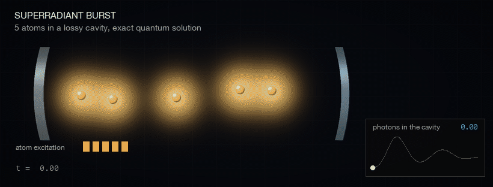
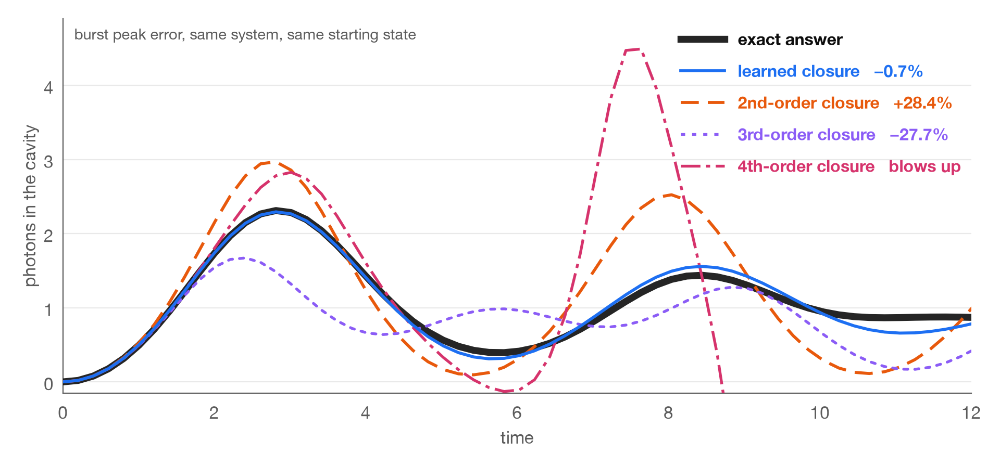
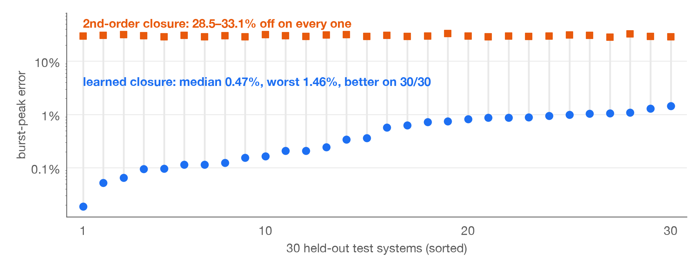
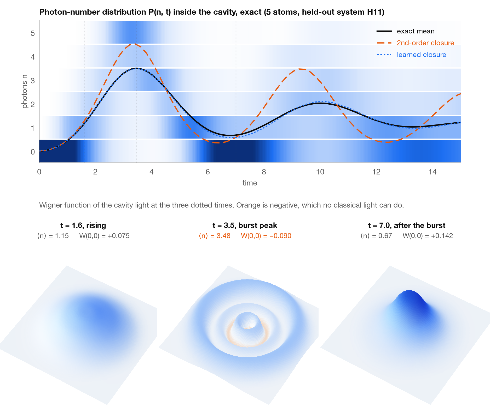
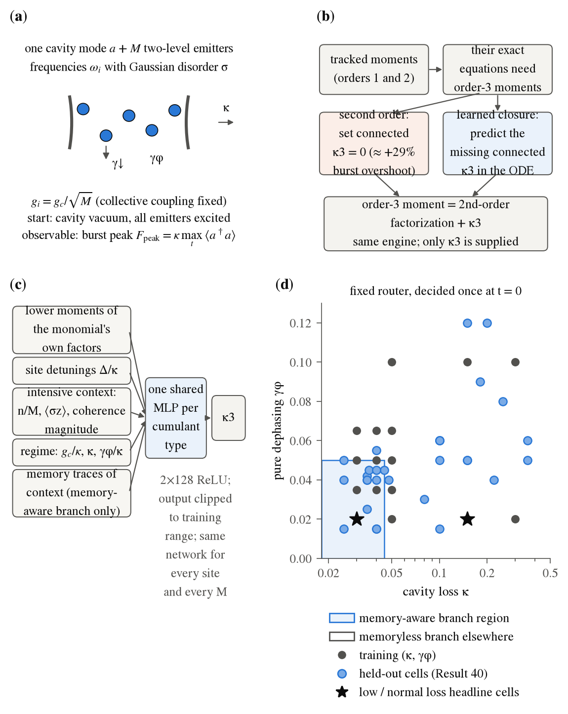
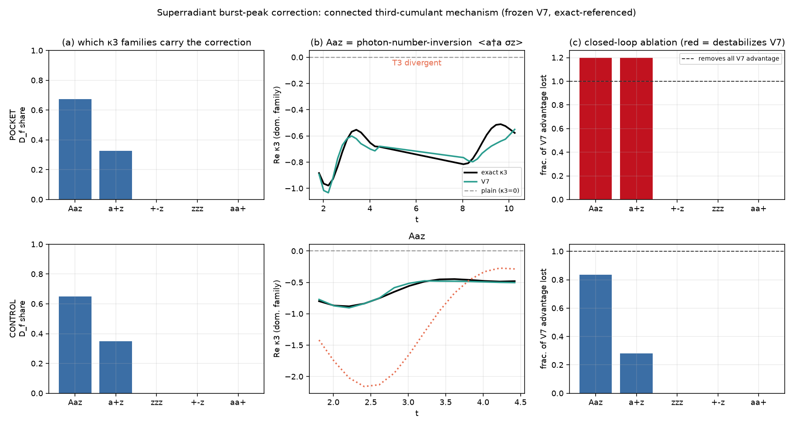
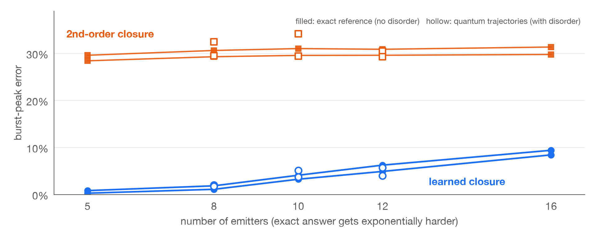
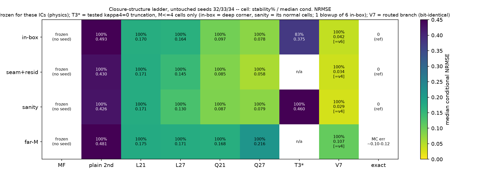

<div align="center">

# Learned Cumulant Closure

**The standard approximation misses this burst of light by about 30%.<br>
A small, physics-constrained neural network gets it within 1.5%, on 30 systems it never saw.**

[**Live demo**](https://dhruvjain35.github.io/superradiance-closure/) &nbsp;|&nbsp;
[The result](#the-result) &nbsp;|&nbsp;
[How it works](#how-it-works) &nbsp;|&nbsp;
[Inside the burst](#inside-the-burst) &nbsp;|&nbsp;
[Where it breaks](#bigger-systems-and-where-it-breaks) &nbsp;|&nbsp;
[Run it](#run-it)


&nbsp;
&nbsp;
&nbsp;

<br>



<sub>Rendered from the exact quantum solution for held-out system H11: each atom glows with its own excitation
probability, the cavity mode with the photon number, and the outgoing beam with the leaked light
(<code>make render</code>). The geometry is illustrative.</sub>

</div>

<picture>
  <source media="(prefers-color-scheme: dark)" srcset="assets/img/hero-dark.png">
  
</picture>

<sub>One system the network never saw (3 atoms, random frequency offsets, low cavity loss), with the same starting
state for every method. Rebuilt from <code>results/baseline_burst_trace_M3_pocket_draw50.npz</code> by
<code>make readme-figures</code>.</sub>

## The problem

Put a few excited atoms in a mirrored cavity and they lock together and release their energy in one bright flash.
That's **superradiance**. Predicting how bright the flash gets is a standard test for open quantum systems, and doing
it exactly is expensive: the quantum state doubles in size with every atom.

So physicists use **cumulant closures**. You track averages and pair correlations, and you approximate the
three-body terms the equations still need. The standard choice sets the connected three-body part (κ₃) to zero. In
an open, disordered cavity that **overshoots the burst peak by about 30%**. Going one order higher doesn't help:
third order undershoots by 25–28% and runs away in the low-loss regime, and fourth order blows up.

**This project keeps the cheap second-order equations and learns only the term they throw away.** A small network
predicts κ₃ from local moments, and the result tracks the exact answer.

## The result

<picture>
  <source media="(prefers-color-scheme: dark)" srcset="assets/img/scoreboard-dark.png">
  
</picture>

The test was **pre-registered**: the 30 parameter points, their seeds and the pass/fail bands were committed before
any of them ran. Each point is a new combination of coupling, cavity loss, dephasing and disorder at five atoms, and
none of them is on the training grid. Twelve sit between training points, twelve lie beyond the training range on
one parameter, and six lie beyond it on two.

| Closure | Burst-peak error vs. exact | Stable? |
|---|---|---|
| Mean field | no burst at all from this starting state | n/a |
| **2nd order (standard)** | **+28.5% to +33.1%** on all 30 held-out systems | yes |
| 3rd order (κ₄ = 0) | −25% to −28% | runs away in the low-loss regime |
| 4th order (κ₅ = 0) | overshoots, then diverges | divergence guard tripped in every 3-atom cell |
| **Learned closure (V7)** | **median 0.47%, worst 1.46%**, better than 2nd order on **30/30** | stable on all 30 |

It is also within 0.8% on the original 24 small-system cells (2–5 atoms, disorder held out). End to end it takes
about 4.6 s, against 21 s for third order and 81 s for fourth (3 atoms, one machine), so it's **18× faster** than the
4th-order closure, which still fails. Each time step costs more than plain second order, so this isn't a free
speedup; the full benchmark is in [`results/runtime_baseline_comparison.md`](results/runtime_baseline_comparison.md).

**Try any of the 30 systems in the [live demo](https://dhruvjain35.github.io/superradiance-closure/).** Its
trajectories are re-run from the frozen models by `scripts/export_demo_data.py`, which checks all 60 burst-peak errors
against the committed record. They match exactly.

## Inside the burst

<picture>
  <source media="(prefers-color-scheme: dark)" srcset="assets/img/inside-burst-dark.png">
  
</picture>

The closures only track averages, so here is what they are averaging. The top panel is the exact probability of
finding *n* photons in the cavity at each moment. During the burst the light is spread over several photon
numbers at once rather than sitting at the mean. The learned closure's mean (dotted blue) rides the exact
mean (white); the 2nd-order closure's (dashed orange) overshoots it on every swing.

The bottom row is the Wigner function of the cavity light, a phase-space picture of a quantum state. Classical light
is never negative there. **At the burst peak it is: W(0,0) = −0.09**, so the flash is genuinely non-classical light.
Before and after the peak it stays positive. (The cavity state here is a mixture of photon-number states, because the start state has a definite
number of excitations and every process in the model conserves or lowers it; that's why the pictures are rings.) Computed with QuTiP by
`make quantum-figures`.

## How it works

<div align="center">

</div>

1. **Track the cheap moments.** The engine follows first- and second-order moments of the cavity field and every
   atom. That's 141 equations at five atoms, where the exact state already has 512 dimensions.
2. **Find what's missing.** The exact equations need third-order moments. Attribution shows the burst error is
   carried by two connected channels: photon number × inversion `⟨a†a σᶻ⟩`, which carries 62–71% of the influence in
   a pre-registered test at five atoms, and field × polarization × inversion `⟨a σ⁺ σᶻ⟩`.
3. **Learn only that term.** For each type of moment, a shared 2×128 ReLU network predicts κ₃ from the moment's own
   factors, its detunings, a few system-wide averages and the regime. The closure is permutation-equivariant
   (relabelling the atoms relabels the output) and Hermiticity-preserving. A frozen router sends the low-loss regime
   to a branch with short memory traces and everything else to a memoryless branch.

<div align="center">

</div>

<sub>(a) The two channels that carry the correction. (b) The dominant channel's κ₃ through the burst: exact and the
learned closure overlie, 3rd order mis-estimates it, and 2nd order sits at zero. (c) Removing either channel degrades
or destabilizes the closure.</sub>

## Bigger systems, and where it breaks

<picture>
  <source media="(prefers-color-scheme: dark)" srcset="assets/img/scaling-dark.png">
  
</picture>

The network was trained on systems of up to five atoms. Past that, the references are symmetry-reduced exact solves
(no disorder, up to 16 atoms) and quantum trajectories (with disorder, up to 12 atoms, about 1% Monte-Carlo error).

- **Accuracy degrades with size.** The error grows about 0.8–0.9 points per atom, to 8–9% at 16 atoms without
  disorder and 4–6% at 12 atoms with it. That's still about 3× better than second order (≈30%), but it isn't
  near-exact any more.
- **Long runs can go unphysical.** In the low-loss regime, trajectories leave the physical set at late times on some
  draws from about 10 atoms, even when the burst peak is still accurate. Three attempted repairs failed. At normal
  loss they stay physical through 20 atoms (no disorder).
- **Untested:** other starting states, other disorder distributions, and γ↓ ≠ 0.02. Out of distribution the picture
  is mixed: it destabilizes on Lorentzian disorder and on a half-inverted start, where second order only degrades.
- **Not exclusive.** Tensor networks, trajectories and higher-order closures can each handle parts of this problem.
  This repository reports what these specific closures do in these specific cells.

## Why the numbers hold up

- **Frozen, then tested.** Both network branches were frozen with recorded SHA-256 hashes before final testing, and
  the held-out campaign refuses to run if a hash doesn't match.
- **Pre-registered.** The held-out test (Result 40) and the five-atom mechanism test (Result 42) were written down
  before they ran. Protocols are in [`docs/PROTOCOL.md`](docs/PROTOCOL.md), and
  [`docs/HISTORY_PROVENANCE.md`](docs/HISTORY_PROVENANCE.md) says, analysis by analysis, which ones were
  pre-registered and which weren't.
- **Reproduced outside, in another language.** A researcher at Notre Dame's Center for Research Computing re-ran
  the baseline (the second-order overshoot) from [`replicate_cumulant.jl`](replicate_cumulant.jl) in
  QuantumCumulants.jl. All six cells returned the overshoot, and the exact peaks matched the Python reference to
  within 4×10⁻⁴. The learned closure itself hasn't been run outside yet; [`portable_v7/`](portable_v7/) is the
  package for that run (NumPy, SciPy and QuTiP only, no pickles).
- **Negatives kept.** A parameter-only routing rule, an atom-count scaling story and a disorder-dependence story were
  each tested and rejected. They stay in [`docs/FINDINGS.md`](docs/FINDINGS.md) (Results 22–24 and 26).
- **Checked automatically.** The CI workflow installs from scratch, runs the import smoke test, re-derives the model conventions
  against closed-form limits, checks the second-order equations against an exactness identity, and verifies the
  portable model against the frozen originals.
- **Every number traced.** Each reported number maps to a script and an output file in
  [`RESULTS_PROVENANCE.md`](RESULTS_PROVENANCE.md).

<details>
<summary><b>More figures: the full closure ladder, runtime, and a rejected hypothesis</b></summary>

<br>

<div align="center">

</div>

<sub>Stability and median trajectory error for each closure structure across regimes, on untouched disorder draws.
Stability at larger sizes depends on the draw: across all of those rollouts the memoryless branch is stable on about
19 of 26 (Result 20).</sub>

<div align="center">

</div>

<sub>Wall-clock time at three atoms on one machine. The learned closure reuses the second-order engine's build and
adds a learned evaluation at each step, instead of constructing a higher-order engine.</sub>

<div align="center">

</div>

<sub>A disorder-dependence hypothesis, tested and rejected: everything moves monotonically with disorder, and there
is no non-monotonic structure.</sub>

</details>

## Run it

```bash
python3.12 -m venv .venv && . .venv/bin/activate
pip install -r requirements-lock.txt   # the exact versions behind the frozen results

make test            # import smoke test (seconds)
make gates           # analytic limits, model conventions, EOM identity (~3 min)
make portable-test   # portable model vs the frozen originals (~2 min)
make burst           # exact vs 2nd order vs the learned closure on the burst peak
make result40        # re-run the 30-system held-out campaign (~50 min on one core)
make figures         # rebuild the paper figures from committed results (no simulation)
make readme-figures  # rebuild the figures on this page
make demo-data       # re-run the demo's 30 systems and check them against the record (~6 min on 8 cores)
make quantum-figures # exact photon distributions and Wigner functions (~10 s)
make render          # render the cavity animation from the exact solution (~1 min)
make demo            # serve the demo at http://127.0.0.1:8000
```

To reproduce the baseline in a separate codebase (Julia):

```bash
julia --project=. julia_setup.jl         # one-time install
julia --project=. replicate_cumulant.jl  # exact vs 2nd-order burst peak -> results/replication_cumulant.csv
```

Start with [`docs/REPLICATION_QUICKSTART.md`](docs/REPLICATION_QUICKSTART.md). The model and its equations of motion
are written out in [`docs/APPENDIX_MODEL_AND_EOM.md`](docs/APPENDIX_MODEL_AND_EOM.md).

## Repository map

```
src/
├── engines/       exact Tavis–Cummings (QuTiP), 2nd-order cumulant, scalable EOM, quantum-trajectory reference
├── closures/      the learned closures (memoryless V4, memory-aware V6) and the V7 router
├── baselines/     κ4 = 0 (3rd order) and κ5 = 0 (4th order) truncations, linear and quadratic baselines
├── data_gen/      training data from exact moment trajectories
├── training/      closure fitting and retraining one rung up the atom-count ladder
├── evaluation/    pilot, campaign, burst-peak, held-out and transfer evaluations
├── analysis/      mechanism attribution and ablation, disorder sweep, interpretability
├── validation/    engine gates and equivalence checks
├── figures/       figure scripts
└── tools/         export of exact replication parameters and of the portable model
portable_v7/       the frozen model as plain arrays, plus a NumPy package that runs it
demo/              the live demo (static; published to GitHub Pages with `make publish-demo`)
scripts/           runtime benchmark, figure builders, the cavity renderer, demo data export
results/           frozen model pickles, logs and the small result files behind every figure
figures/           the five main figures (PDF, PNG, EPS)
docs/              FINDINGS (every result, including rejected ones), PROTOCOL, replication guides
```

## Status

The manuscript is in preparation for *Physical Review A*. This repository is the public release of the code and
results. The development history, the paper source and the outside collaborator's returned files stay in a private
repository until the paper is out, so the commit hashes cited in `docs/` and `RESULTS_PROVENANCE.md` refer to that
history.

## Cite and license

Cite via [`CITATION.cff`](CITATION.cff) (GitHub's "Cite this repository" button). Physics and methods references
are in [`references.bib`](references.bib). The code is MIT licensed; see [`LICENSE`](LICENSE).
